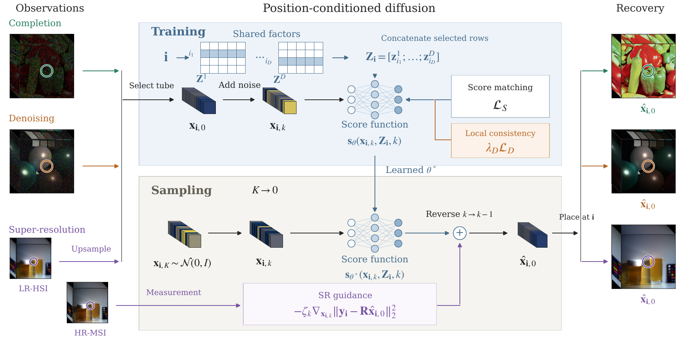

# DiffTR: Shared Factor Guided Diffusion for Low-Rank Tensor Recovery

DiffTR learns a coordinate-conditioned tensor representation from the available observations. Shared mode factors condition a compact diffusion network; scalar and tube outputs support tensor completion, mixed-noise denoising, and hyperspectral super-resolution.

## Overview 

<p align="center">
  
</p>

Coordinate-indexed factors encode dependencies shared across tensor entries. Score matching learns the factors and conditional score together. Completion samples missing entries or tubes; denoising combines clean-value estimation, sparse-noise separation, and optional spatial consistency. Super-resolution learns from LR-HSI and uses HR-MSI guidance followed by observation and spectral-subspace refinement. Each tensor supplies its own training observations.

## Environment

The implementation uses Python 3.10, PyTorch 2.4.1, and torchvision 0.19.1. Experiments were conducted on NVIDIA RTX 3090 GPUs. Training requires a CUDA-enabled GPU and a compatible PyTorch installation. Dependencies are listed in `requirements.txt`.

```bash
python3.10 -m venv .venv
source .venv/bin/activate
python -m pip install -r requirements.txt

# Run a small synthetic training and reconstruction example.
CUDA_VISIBLE_DEVICES='' python scripts/smoke_test.py
```

`rff/` is bundled and imported locally. CS2DIPs uses `torchvision.ops.DeformConv2d` through an adapter, so a separate MMCV installation is unnecessary. GTNN/GNLTN have Python implementations; MATLAB is unnecessary for their released runners. A Linux shell is expected for GPU scheduling and process locks.

## Data

Follow [data/readme.md](data/readme.md) for filenames, formats, scene lists, and preprocessing. Data and trained checkpoints are supplied separately; the small spectral response matrices are included.

```bash
python scripts/check_data.py all
# Or check only the intended task:
python scripts/check_data.py sr
```

## Quick start

The unified launcher prints commands by default. Add `--execute` to train. It uses the active Python interpreter, assigns one process per listed GPU, writes logs, and skips successfully completed launcher jobs. Run a single launcher per output directory.

```bash
# One visual completion experiment.
python scripts/run_experiments.py completion-entry --key RGB_Peppers_sr0.1 --execute --gpus 0
```

The equivalent shell entry point is `bash scripts/run_main.sh <suite> [options]`. `PYTHON=/path/to/python` selects its interpreter. For direct experiment entry points, `--dev` selects a GPU unless `CUDA_VISIBLE_DEVICES` is already set; the launcher sets this environment variable for each worker.

## Main experiments

| Paper experiment | Launcher suite / entry point | Scope |
|---|---|---|
| Sparse and continuous tensor completion | `tabular` | Alog, ACC, Air, Click; ranks 3/5/8/10 |
| Random-entry visual completion | `completion-entry` | RGB/MSI/video; 5/10/15/20/25% observations |
| Tube completion | `completion-tube` | Same scene/rate matrix, vector outputs |
| Main denoising comparison | `denoising` | 50 scene/noise combinations; selected BCD or likelihood recipe |
| Hyperspectral super-resolution | `sr` | WDC, PaviaU, CAVE |
| Component and sampling ablations | `ablation_study/run.py` | Coordinate, sparse, spatial, step-count, guidance controls |
| Observation-adaptation studies | `run_guided_denoising_study.py` | Likelihood, staged diffusion, and loss controls |
| SR refinement ablation | `scripts/run_terminal_ablation.py` | Reconstruction refinement controls |

### Tensor completion

```bash
python scripts/run_experiments.py tabular --execute --gpus 0
python scripts/run_experiments.py completion-entry --execute --gpus 0
python scripts/run_experiments.py completion-tube --execute --gpus 0

# Direct entry points for individual settings:
python exp_diff_alog.py --rank 3 --dev 0
python exp_diff_air.py --rank 5 --dev 0
python exp_diff_imgC.py --type MSI --name balloons --SR 0.1 --tube --dev 0
python exp_diff_imgC.py --type y4m --name foreman --SR 0.1 --dev 0
```

Checkpoints and JSON summaries are separated by dataset, scene/rank, sampling rate, tube mode, seed, and fold under `outputs/completion/`. Alog, Air, and Click use five stored folds.

### Denoising

```bash
python scripts/run_experiments.py denoising --execute --gpus 0
python scripts/aggregate.py denoising

# An individual BCD run:
python exp_diff_imgD.py --group CAVE --name balloons --case 1 --dev 0 \
  --noise-protocol legacy --rank 8 --steps 40000 --eval-every 1000 \
  --sparse-mode on --sparse-threshold 0.04 --smooth-weight 0.01

# Full-patch likelihood/proximal configuration used for WDC Case 1:
python run_guided_denoising.py --scene WDC --patch 0 --case 1 --variant likelihood \
  --crop 0 --steps 10000 --batch-size 8192 --rank 8 --guidance 1 \
  --noise-protocol legacy --device cuda:0 --output outputs/denoise_example
```

The launcher applies the paper’s denoising configurations automatically. BCD runs use reference-PSNR checkpoint selection; likelihood-based runs use final EMA weights. See the paper for detailed settings. Full-patch Cases 3/5 use independent per-voxel zero masks, selected explicitly with `--noise-protocol legacy`.

### Hyperspectral super-resolution (SR)

DiffTR reconstructs an HR-HSI from an LR-HSI and an HR-MSI. Prepare WDC, PaviaU, or CAVE data following [data/readme.md](data/readme.md); the spectral response matrices are included.

```bash
# Train and evaluate DiffTR on one setting.
python scripts/run_experiments.py sr --key PaviaU_PaviaU_patch0_DS4_sigma0.5 \
  --methods DiffTR --execute --gpus 0

# Run the full SR comparison, including GTNN, GNLTN, CS2DIPs, and EDIP-Net.
python scripts/run_experiments.py sr --execute --gpus 0

# Summarize results and generate comparison figures after the full run.
python scripts/aggregate.py sr
python scripts/plot_sr.py
```

Remove `--execute` to preview commands. Use `--gpus 0 1 2` for multiple GPUs, or `--methods DiffTR` for DiffTR only. Baselines use the corresponding DiffTR training time as their optimization budget. Checkpoints, reconstructions, metrics, and logs are saved under `outputs/sr/`. Experiment settings are provided by the configs and launcher.

#### SR inference API

For an already loaded model, call the SR reconstruction function directly:

```python
from Diff.sr_reconstruction import reconstruct_sr

diff.eval().requires_grad_(False)
reconstruction, diagnostics = reconstruct_sr(diff, lr_hsi, sigma=0.5, scale=4)
```

`diff` holds the trained model, HR-MSI observation, and spectral response. `lr_hsi` is the LR-HSI tensor on the same device. `sigma` specifies blur severity and `scale` the spatial downsampling factor. This interface is specific to SR and returns the reconstructed cube and solver diagnostics.

## Ablations

```bash
# Run component and sampling ablations.
# First train the WDC and PaviaU patch0 / DS4 / sigma0.5 SR checkpoints above.
python ablation_study/run.py
python ablation_study/run.py --execute --gpus 0
python ablation_study/analyze.py
python ablation_study/verify_reconstructions.py

# Likelihood and staged studies: 96x96 crops, 4,000 updates, guidance 0/1/4.
python run_guided_denoising_study.py --root outputs/guidance \
  --variants likelihood staged --devices 0

# Loss controls on WDC Cases 1/2/3.
python run_guided_denoising_study.py --root outputs/loss_controls \
  --scenes WDC --variants mse huber noisy_multi --devices 0

# Additional Case 2 run on both scenes.
python run_guided_denoising_study.py --root outputs/guidance_repeat \
  --cases 2 --variants likelihood --seeds 3408 --devices 0

# Preview the required SR settings, then run refinement ablations using trained checkpoints.
python scripts/run_terminal_ablation.py
python scripts/run_terminal_ablation.py --execute --device cuda:0
python scripts/run_terminal_ablation.py --sensitivity --execute --device cuda:0
```

SR ablations use checkpoints from `outputs/sr/`. Train the corresponding settings first. For a custom checkpoint location, use `ablation_study/superres.py --checkpoint-dir <path>`.
